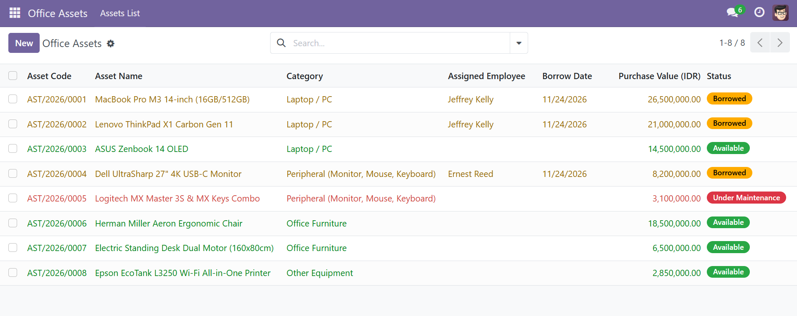
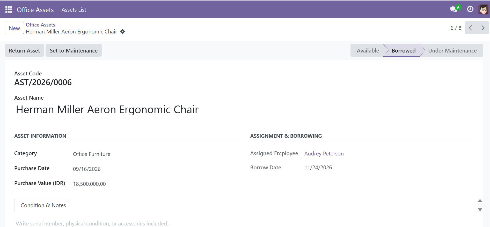
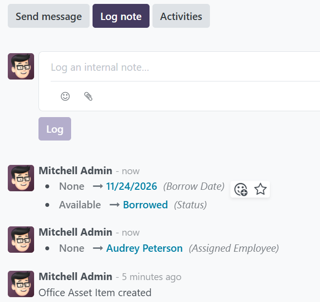
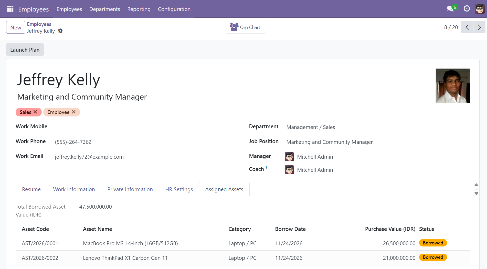

# Office Asset Management (Odoo 17 Custom Module)

A custom ERP module built for **Odoo 17 Community Edition** to streamline company asset tracking, employee assignments, borrowing lifecycles, and real-time asset valuation.

## Key Features

- **Automated Asset Sequencing (`ir.sequence`):** Automatically generates unique asset codes (`AST/YYYY/0001`) upon record creation by overriding `@api.model_create_multi def create()`.
- **State-Driven Workflow & Validations:** Interactive header actions (`Borrow Asset`, `Return Asset`, `Set to Maintenance`) with server-side Python constraints (`ValidationError`) and SQL uniqueness checks (`_sql_constraints`).
- **HR Module Inheritance (`_inherit = 'hr.employee'`):** Extends Odoo's native Employee model and form view via XML XPath to display an **Assigned Assets** tab directly inside each employee's profile.
- **Real-Time Computed Valuation (`@api.depends`):** Dynamically calculates the total monetary value (`total_asset_value`) of all currently borrowed assets assigned to an employee.
- **Audit Trail & Chatter (`mail.thread`):** Tracks field changes (status transitions, employee assignments, valuation updates) automatically in the record chatter.

## Tech Stack

- **Framework:** Odoo 17.0 (Python ORM, XML Views, XPath)
- **Database:** PostgreSQL
- **Security:** Role-based access control configured via `ir.model.access.csv`

## Screenshots

### 1. Asset List View (Tree View)

Color-coded status badges (`Available`, `Borrowed`, `Under Maintenance`) with automated asset sequence codes.

### 2. Asset Form & Workflow

Detailed asset form with state-driven action buttons and employee assignment mapping.

### 3. Automated Audit Trail (Chatter)

Real-time logging of record creation, status transitions, and employee assignments via `mail.thread`.

### 4. HR Employee Profile Inheritance

Extended `hr.employee` form view displaying assigned assets (`One2many`) and real-time total asset valuation (`@api.depends`).

## Installation

1. Clone this repository into your Odoo custom `addons_path`.
2. Restart the Odoo server service.
3. Activate **Developer Mode** in Odoo Settings.
4. Navigate to **Apps** → **Update Apps List**, search for **Office Asset Management**, and click **Activate**.
